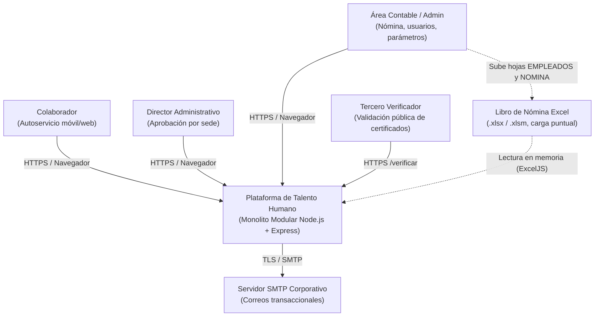
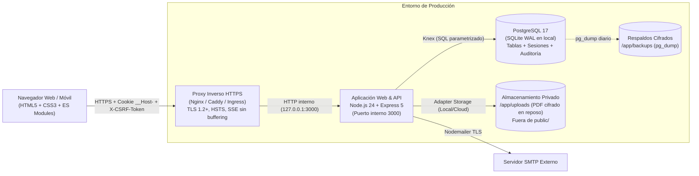
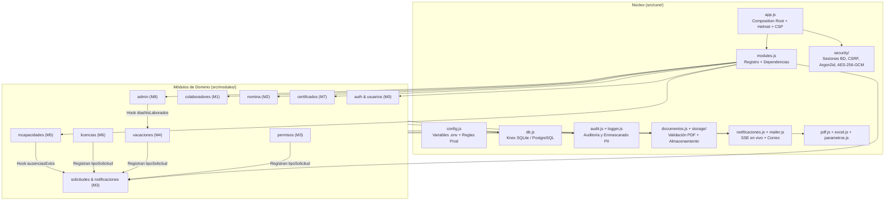
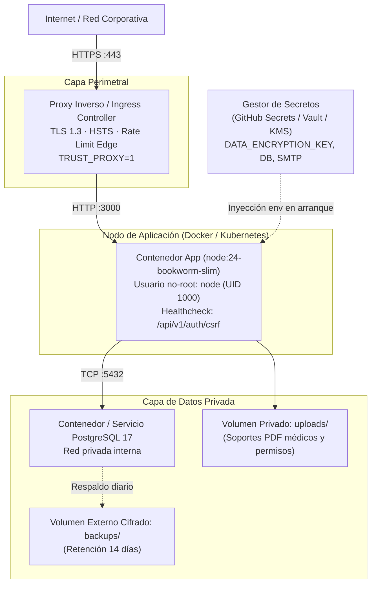

# Arquitectura del Sistema — Modelo C4

Este documento describe la arquitectura de la **Plataforma de Talento Humano** siguiendo los cuatro niveles del **Modelo C4** (Contexto, Contenedores, Componentes y Despliegue).

---

## 1. Diagrama de Contexto del Sistema (Nivel 1)

Muestra los actores que interactúan con la plataforma y los sistemas externos con los que se integra.

---

## 2. Diagrama de Contenedores (Nivel 2)

Detalla los bloques ejecutables y almacenes de datos que conforman el sistema en producción.

---

## 3. Diagrama de Componentes (Nivel 3)

Representa la estructura interna del Monolito Modular (`src/core/` y `src/modules/`).

---

## 4. Diagrama de Despliegue (Nivel 4)

Ilustra la topología física/lógica recomendada con Docker Compose o Kubernetes detrás de un terminador TLS.

