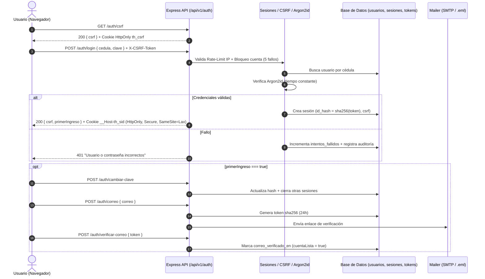
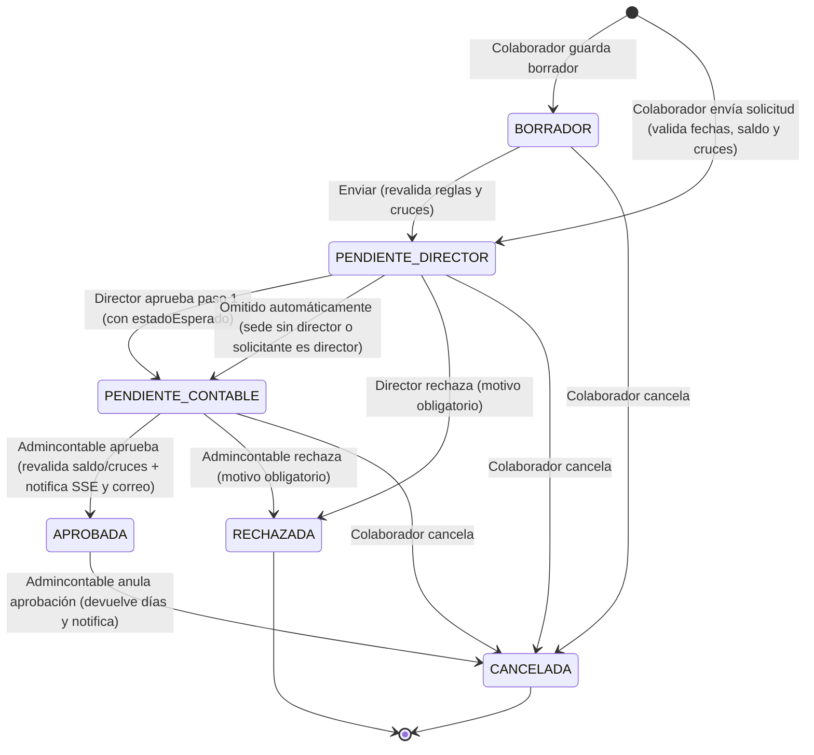
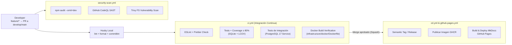

# Flujos de Arquitectura y Operación

Este documento detalla los flujos críticos de **Autenticación**, **Negocio** y **CI/CD**.

---

## 1. Flujo de Autenticación, Sesión y Primer Ingreso

---

## 2. Flujo de Negocio: Motor de Solicitudes y Aprobaciones

---

## 3. Flujo CI/CD y Seguridad (GitHub Actions)

