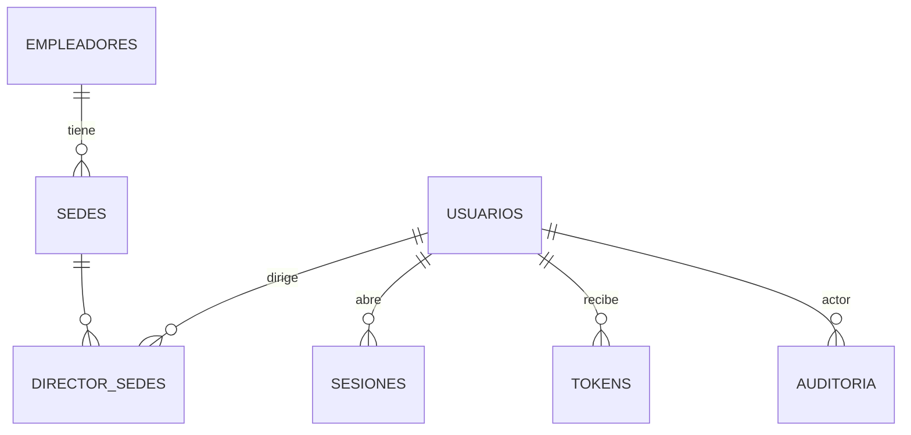
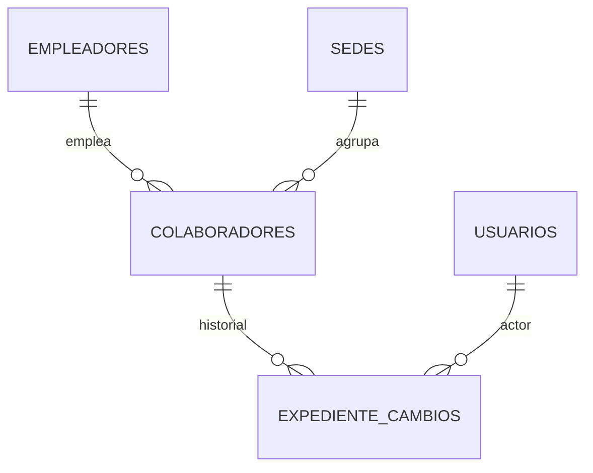
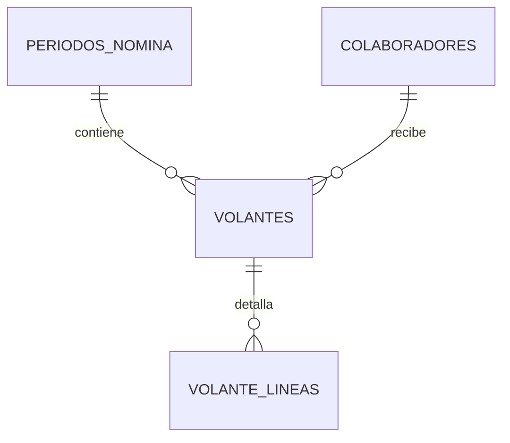
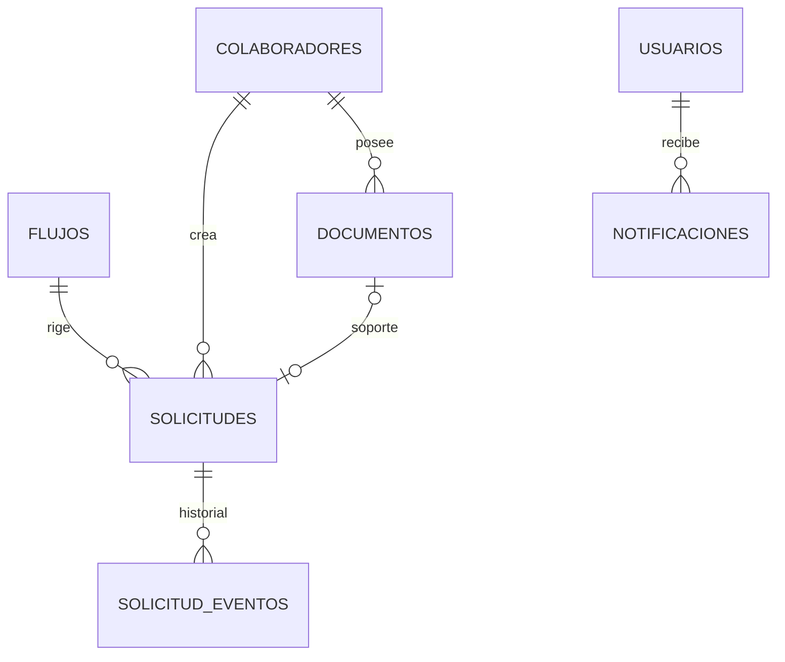

# Modelo de datos

Fechas y horas en texto ISO-8601 UTC (`AAAA-MM-DDTHH:mm:ss.sssZ`); fechas puras en `AAAA-MM-DD`. Así el esquema es idéntico en SQLite y PostgreSQL. El modelo completo previsto está en [plan.md §3](plan.md); aquí solo lo ya construido.

## M0 (migración `20261121_001_m0_nucleo`)

| Tabla | Campo | Notas |
|---|---|---|
| **empleadores** | id, clave (único), razon_social, documento | |
| **sedes** | id, empleador_id, nombre, orden, activa | único (empleador_id, nombre). Área = sede (supuesto P1) |
| **usuarios** | id, cedula (único), nombre, rol | rol: `COLABORADOR` · `DIRECTOR` · `ADMIN` |
| | activo | desactivar cierra sesiones |
| | password_hash, password_hash_anterior | argon2id; la anterior impide reutilizarla |
| | debe_cambiar_clave, clave_temporal_expira | temporal: 72 h |
| | correo, correo_verificado_en | solo se guarda tras verificar |
| | intentos_fallidos, bloqueado_hasta | `LOGIN_MAX_INTENTOS`, `LOGIN_BLOQUEO_MIN` |
| | ultimo_acceso, creado_por, creado_en, actualizado_en | |
| **director_sedes** | usuario_id, sede_id | alcance del director |
| **sesiones** | id_hash (PK), usuario_id, csrf, creada_en, ultimo_uso, expira_absoluta, ip, user_agent | `id_hash` = sha256 del token de la cookie (la cookie nunca se guarda en claro) |
| **tokens** | id, usuario_id, tipo, hash, dato, expira_en, usado_en, creado_en | tipo: `VERIFICAR_CORREO` (24 h) · `RECUPERAR` (1 h). Un token nuevo anula los anteriores |
| **parametros** | id, clave, valor (JSON), tipo, vigente_desde, vigente_hasta, descripcion, actualizado_por, actualizado_en | único (clave, vigente_desde). Se lee el vigente a una fecha |
| **festivos** | fecha (PK), anio, nombre | 2026–2027 desde el archivo base |
| **auditoria** | id, actor_id, accion, entidad, entidad_id, detalle (JSON), ip, user_agent, creado_en | `detalle` omite claves, tokens, hash, diagnósticos y cuentas |

### Acciones de auditoría registradas en M0
`LOGIN`, `LOGIN_FALLIDO` (motivo: no_existe, inactivo, bloqueado, clave, temporal_vencida), `BLOQUEO`, `LOGOUT`, `CAMBIO_CLAVE`, `CORREO_REGISTRADO`, `CORREO_VERIFICADO`, `RECUPERACION_SOLICITADA`, `RECUPERACION_IGNORADA`, `CLAVE_RESTABLECIDA`, `CREAR`, `EDITAR` (antes/después), `VER`, `RESTABLECER_CLAVE`, `CARGA_MASIVA`.

### Parámetros cargados
Ver `seeds/datos-iniciales.js`. Los marcados **VERIFICAR** (dominical 100 % desde 01/07/2027, factores dominicales de horas extra 2027 y el tope de compensación de vacaciones del 50 %) deben confirmarse con un asesor laboral.

## M1 (migración `20261122_002_m1_expediente`)

| Tabla | Campos | Notas |
|---|---|---|
| **colaboradores** | id, cedula (único), nombre, empleador_id, sede_id, cargo, rango, tipo_contrato, fecha_ingreso, fecha_fin_contrato, salario_base, aux_transporte, dia_descanso, esquema_horas, lactancia, fin_lactancia, eps, afp, fondo_cesantias, caja, arl_riesgo, banco, tipo_cuenta, **numero_cuenta_cifrado**, estado, fecha_retiro, motivo_retiro, fecha_nacimiento, sexo, estado_civil, nacionalidad, ciudad_nacimiento, ciudad_residencia, direccion, barrio, celular, contacto_emergencia_nombre, contacto_emergencia_telefono, creado_en, actualizado_en | Se relaciona con `usuarios` por la **cédula** (sin FK) para que los módulos sean independientes. El número de cuenta se guarda con AES-256-GCM |
| **expediente_cambios** | id, colaborador_id, campo, valor_anterior, valor_nuevo, origen (`COLABORADOR`/`ADMIN`/`IMPORTACION`), actor_id, creado_en | Valores legibles (nombre de la sede, SI/NO); la cuenta se guarda enmascarada (`•••• 1234`). `campo = _alta` marca la creación |

El catálogo de campos (etiqueta, grupo, tipo, lista de valores, visibilidad para el director) está en `src/modules/colaboradores/campos.js` y es la única fuente para validar, decidir permisos y pintar la interfaz.

### Parámetros nuevos
`LISTA_CONTRATOS`, `LISTA_EPS`, `LISTA_AFP`, `LISTA_BANCOS`, `LISTA_TIPO_CUENTA`, `LISTA_ARL`, `LISTA_MOTIVOS_RETIRO`, `LISTA_DIAS`, `LISTA_ESQUEMAS` (del archivo base), `LISTA_ESTADO_CIVIL`, `LISTA_SEXO` y `CAMPOS_EDITABLES_COLABORADOR` (supuesto P11).

## M2 (migración `20261122_003_m2_nomina`)

| Tabla | Campos | Notas |
|---|---|---|
| **periodos_nomina** | id, nombre_hoja, fecha_inicio, fecha_fin, estado (`BORRADOR`/`PUBLICADO`/`ANULADO`), colaboradores, total_devengado, total_deducido, total_neto, total_adicional, archivo_nombre, archivo_sha256, advertencias (JSON), cargado_por/en, publicado_por/en, anulado_por/en, motivo_anulacion | Índice único parcial `(fecha_inicio, fecha_fin) WHERE estado <> 'ANULADO'`: un solo periodo vigente por rango |
| **volantes** | id, periodo_id, colaborador_id, cedula, nombre, empleador, empleador_documento, sede, cargo, rango, dias, salario_base, total_devengado, total_deducido, neto, total_adicional, eps, afp, observacion, fila_origen | Copia de lo que dice la hoja: el volante no cambia si luego se edita el expediente. Único `(periodo_id, colaborador_id)` |
| **volante_lineas** | id, volante_id, concepto, tipo (`DEV`/`DED`/`ADICIONAL`), etiqueta, cantidad, unidad, valor, detalle (JSON), orden | Solo conceptos con valor ≠ 0. Deducciones en positivo. `detalle`: horas por tipo de HORAS RESUMEN (informativo) |

El catálogo de conceptos (columna de la hoja, etiqueta, orden) está en `src/modules/nomina/conceptos.js`. **No hay tabla `conceptos`**: los conceptos los fija el formato del archivo, no se configuran.

## M3 (migración `20261122_005_m3_solicitudes`)

| Tabla | Campos | Notas |
|---|---|---|
| **flujos** | id, tipo, version, pasos (JSON `[{ rol, estado, etiqueta }]`), activo, creado_por, creado_en | Una versión activa por tipo; por defecto director → admincontable (S1) |
| **solicitudes** | id, tipo, subtipo, colaborador_id, flujo_id, paso_actual, estado, fecha_inicio, hora_inicio, fecha_fin, hora_fin, dias_habiles, dias_compensar, motivo, documento_id, datos (JSON), creado/actualizado/enviado/resuelto_en | Estados: BORRADOR, PENDIENTE_DIRECTOR, PENDIENTE_CONTABLE, APROBADA, RECHAZADA, CANCELADA |
| **solicitud_eventos** | id, solicitud_id, actor_id, accion, estado_desde, estado_hasta, comentario, creado_en | CREAR, ENVIAR, APROBAR, RECHAZAR, CANCELAR |
| **documentos** | id, colaborador_id, categoria, storage_key, nombre_original, mime, tamano, sha256, sensible, subido_por, creado_en | El archivo vive fuera de la carpeta pública con nombre aleatorio (`src/core/storage`); `sensible` = datos de salud |
| **notificaciones** | id, usuario_id, titulo, mensaje, enlace, leida, creada_en | |

Parámetros nuevos: `LISTA_TIPOS_PERMISO`, `PERMISO_MAX_DIAS`.

## M4 (migración `20261122_006_m4_vacaciones`)

| Tabla | Columnas | Notas |
|---|---|---|
| **saldos_vacaciones** | id, colaborador_id, fecha_corte, dias_al_corte (2 decimales), observacion, registrado_por, registrado_en | Días pendientes **antes** de la fecha de corte (P8). Se conserva cada registro y vale el de fecha de corte más reciente. Los datos semilla son ficticios |

Las solicitudes de vacaciones usan la tabla `solicitudes` (M3):
- `dias_habiles` = días a disfrutar y `dias_compensar` = días en dinero.
- `fecha_fin` = último día hábil.
- `datos` = `{ regreso, saldoAlEnviar, festivos[] }`.

### Acciones de auditoría nuevas
`REGISTRAR_SALDO_VACACIONES` (detalle con el saldo antes y después; `autoregistro: true` si es el propio) y `VER_VACACIONES`.
## M5 (migración `20261122_007_m5_incapacidades`)

| Tabla | Columnas | Notas |
|---|---|---|
| **incapacidades** | id, colaborador_id, tipo (IGE/IRL), entidad, fecha_inicio, fecha_fin, dias, prorroga_de, numero_certificado, **diagnostico_cifrado** (AES-256-GCM), documento_id (sensible), estado, motivo_estado, registrado_por, revisado_por, revisado_en, creado/actualizado_en | Estados: REGISTRADA, VALIDADA, DEVUELTA, ANULADA |

### Parámetros nuevos
- `INC_MAX_DIAS` = 180. Es un control de digitación; está marcado VERIFICAR.
- `INC_REGISTRO_MAX_DIAS_ATRAS` = 60. Está marcado VERIFICAR.

### Acciones de auditoría nuevas
- `REGISTRAR_INCAPACIDAD`
- `VER_INCAPACIDAD`
- `VER_INCAPACIDADES`
- `INCAPACIDAD_VALIDADA`, `INCAPACIDAD_DEVUELTA` e `INCAPACIDAD_ANULADA`

Ninguna guarda el diagnóstico.
## M6 (sin migración)

Las licencias se guardan en `solicitudes` (`tipo = LICENCIA`):
- `subtipo` = nombre del tipo.
- `datos` = `{ dias, unidad, codigo, remunerada, descuentaVacaciones, sensible }`, una copia de la regla vigente al pedirla.

### Parámetros nuevos
- `LISTA_TIPOS_LICENCIA` (JSON por tipo).
- `LIC_REGISTRO_MAX_DIAS_ATRAS` = 30.

Ambos están marcados VERIFICAR.
## M7 (migración `20261122_008_m7_certificados`)

| Tabla | Columnas | Notas |
|---|---|---|
| **certificados** | id, colaborador_id, tipo (LABORAL), con_salario, **codigo** (único), dirigido_a, contenido (JSON impreso), huella (sha256), emitido_por, emitido_en, anulado_en, anulado_por, motivo_anulacion | La verificación pública solo lee `codigo`, `anulado_en` y `emitido_en` |

### Acciones de auditoría nuevas
`EMITIR_CERTIFICADO`, `DESCARGAR_CERTIFICADO` y `ANULAR_CERTIFICADO`.
## M8 (migración `20261122_009_m8_suspensiones`)

| Tabla | Columnas | Notas |
|---|---|---|
| **suspensiones** | id, colaborador_id, fecha_inicio, fecha_fin, dias, motivo, registrado_por, creado_en, anulada_en, anulada_por, motivo_anulacion | Novedad SUS. Anular no borra |

- **`solicitudes.estado`:** nuevo valor `ANULADA`.
- **`parametros`:** cada cambio es una fila nueva (clave + `vigente_desde` único). `vigente_hasta` de la anterior = día antes de la nueva.

### Acciones de auditoría nuevas
- `PROGRAMAR_PARAMETRO` y `BORRAR_PARAMETRO_PROGRAMADO`
- `GUARDAR_FESTIVOS`
- `ANULAR` (solicitud)
- `REGISTRAR_SUSPENSION` y `ANULAR_SUSPENSION`
- `VER_AUSENTISMO` y `VER_AUDITORIA`