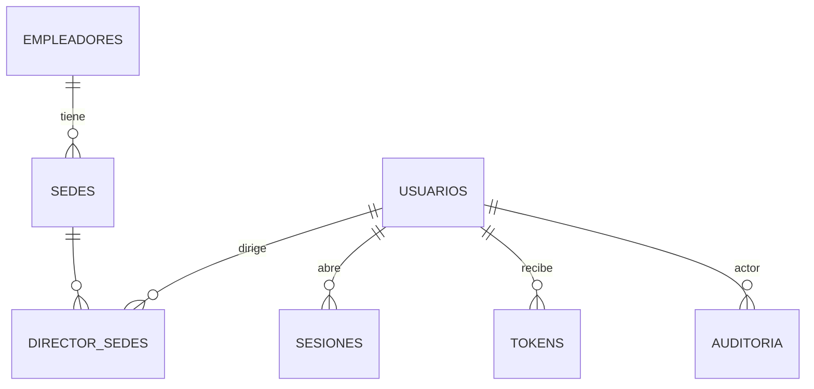
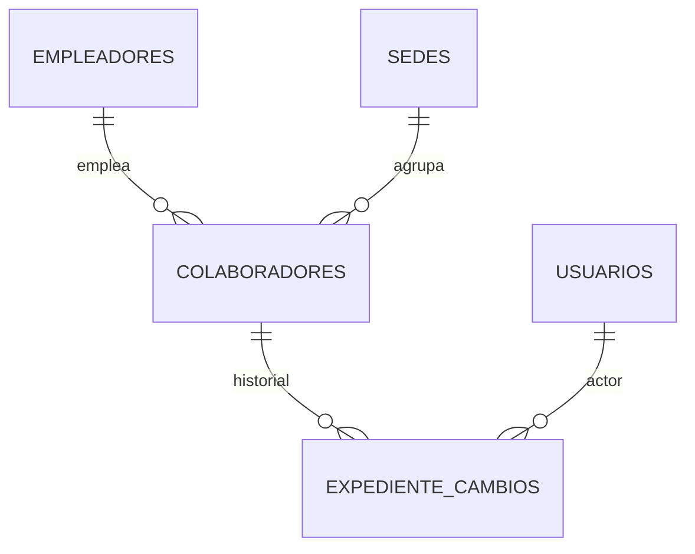

# Modelo de datos

Fechas y horas en texto ISO-8601 UTC (`AAAA-MM-DDTHH:mm:ss.sssZ`); fechas puras en `AAAA-MM-DD`. Así el esquema es idéntico en SQLite y PostgreSQL. El modelo completo previsto está en [plan.md §3](plan.md); aquí solo lo ya construido.

## M0 (migración `20261121_001_m0_nucleo`)

| Tabla | Campo | Notas |
|---|---|---|
| **empleadores** | id, clave (único), razon_social, documento | |
| **sedes** | id, empleador_id, nombre, orden, activa | único (empleador_id, nombre). Área = sede (supuesto P1) |
| **usuarios** | id, cedula (único), nombre, rol | rol: `COLABORADOR` · `DIRECTOR` · `ADMIN` |
| | activo | desactivar cierra sesiones |
| | password_hash, password_hash_anterior | argon2id; la anterior impide reutilizarla |
| | debe_cambiar_clave, clave_temporal_expira | temporal: 72 h |
| | correo, correo_verificado_en | solo se guarda tras verificar |
| | intentos_fallidos, bloqueado_hasta | `LOGIN_MAX_INTENTOS`, `LOGIN_BLOQUEO_MIN` |
| | ultimo_acceso, creado_por, creado_en, actualizado_en | |
| **director_sedes** | usuario_id, sede_id | alcance del director |
| **sesiones** | id_hash (PK), usuario_id, csrf, creada_en, ultimo_uso, expira_absoluta, ip, user_agent | `id_hash` = sha256 del token de la cookie (la cookie nunca se guarda en claro) |
| **tokens** | id, usuario_id, tipo, hash, dato, expira_en, usado_en, creado_en | tipo: `VERIFICAR_CORREO` (24 h) · `RECUPERAR` (1 h). Un token nuevo anula los anteriores |
| **parametros** | id, clave, valor (JSON), tipo, vigente_desde, vigente_hasta, descripcion, actualizado_por, actualizado_en | único (clave, vigente_desde). Se lee el vigente a una fecha |
| **festivos** | fecha (PK), anio, nombre | 2026–2027 desde el archivo base |
| **auditoria** | id, actor_id, accion, entidad, entidad_id, detalle (JSON), ip, user_agent, creado_en | `detalle` omite claves, tokens, hash, diagnósticos y cuentas |

### Acciones de auditoría registradas en M0
`LOGIN`, `LOGIN_FALLIDO` (motivo: no_existe, inactivo, bloqueado, clave, temporal_vencida), `BLOQUEO`, `LOGOUT`, `CAMBIO_CLAVE`, `CORREO_REGISTRADO`, `CORREO_VERIFICADO`, `RECUPERACION_SOLICITADA`, `RECUPERACION_IGNORADA`, `CLAVE_RESTABLECIDA`, `CREAR`, `EDITAR` (antes/después), `VER`, `RESTABLECER_CLAVE`, `CARGA_MASIVA`.

### Parámetros cargados
Ver `seeds/datos-iniciales.js`. Los marcados **VERIFICAR** (dominical 100 % desde 01/07/2027, factores dominicales de horas extra 2027 y el tope de compensación de vacaciones del 50 %) deben confirmarse con un asesor laboral.

## M1 (migración `20261122_002_m1_expediente`)

| Tabla | Campos | Notas |
|---|---|---|
| **colaboradores** | id, cedula (único), nombre, empleador_id, sede_id, cargo, rango, tipo_contrato, fecha_ingreso, fecha_fin_contrato, salario_base, aux_transporte, dia_descanso, esquema_horas, lactancia, fin_lactancia, eps, afp, fondo_cesantias, caja, arl_riesgo, banco, tipo_cuenta, **numero_cuenta_cifrado**, estado, fecha_retiro, motivo_retiro, fecha_nacimiento, sexo, estado_civil, nacionalidad, ciudad_nacimiento, ciudad_residencia, direccion, barrio, celular, contacto_emergencia_nombre, contacto_emergencia_telefono, creado_en, actualizado_en | Se relaciona con `usuarios` por la **cédula** (sin FK) para que los módulos sean independientes. El número de cuenta se guarda con AES-256-GCM |
| **expediente_cambios** | id, colaborador_id, campo, valor_anterior, valor_nuevo, origen (`COLABORADOR`/`ADMIN`/`IMPORTACION`), actor_id, creado_en | Valores legibles (nombre de la sede, SI/NO); la cuenta se guarda enmascarada (`•••• 1234`). `campo = _alta` marca la creación |

El catálogo de campos (etiqueta, grupo, tipo, lista de valores, visibilidad para el director) está en `src/modules/colaboradores/campos.js` y es la única fuente para validar, decidir permisos y pintar la interfaz.

### Parámetros nuevos
`LISTA_CONTRATOS`, `LISTA_EPS`, `LISTA_AFP`, `LISTA_BANCOS`, `LISTA_TIPO_CUENTA`, `LISTA_ARL`, `LISTA_MOTIVOS_RETIRO`, `LISTA_DIAS`, `LISTA_ESQUEMAS` (del archivo base), `LISTA_ESTADO_CIVIL`, `LISTA_SEXO` y `CAMPOS_EDITABLES_COLABORADOR` (supuesto P11).
