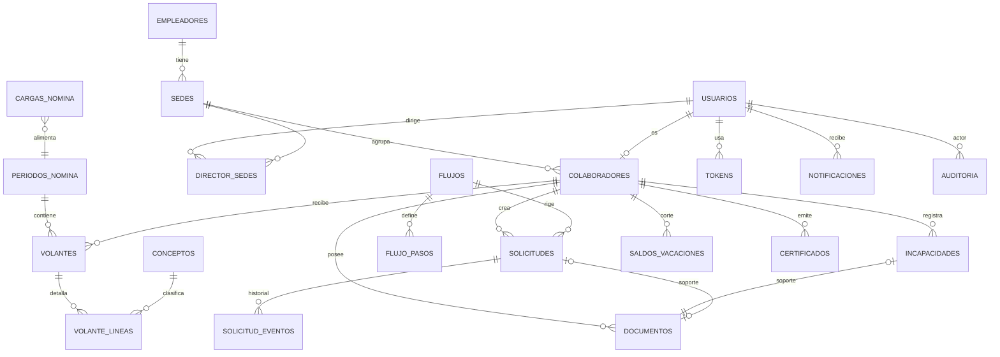

# Fase 1 – Plan

Plataforma de Talento Humano · Masinero Compraventas
Fecha: 21/11/2026 · Estado: **esperando aprobación** · Base: [analisis.md](analisis.md)

---

## 1. Arquitectura

```
Navegador (HTML + CSS + JS módulos ES, primero móvil)
        │  fetch JSON /api/v1/*  · cookie de sesión HttpOnly + token CSRF
        ▼
Express (Node 20 LTS)
  core/      ── app, config (.env), registro de módulos, sesión, CSRF, helmet,
  │             RBAC + alcance, auditoría, errores, correo, almacenamiento, PDF, workflow
  modules/   ── auth · colaboradores · nomina · solicitudes(permisos/vacaciones/licencias)
  │             incapacidades · certificados · admin · parametros
  ▼
Knex ──► SQLite (local)  |  PostgreSQL (producción)      Almacenamiento: disco privado | nube (adaptador)
```

- **Monolito modular.** Cada módulo exporta `{ name, routes, migrations?, views, permissions }` y se registra en `core/modules.js`. Un módulo se activa o desactiva con `MODULES_ENABLED` en `.env`; si está desactivado, no monta rutas ni muestra menú.
- **Las reglas viven en la BD** (tabla `parametros` con vigencias) y el **flujo de aprobación es configuración** (`flujos` + `flujo_pasos`).
- **Frontend sin framework:** páginas HTML por módulo (`modules/<m>/views/*.html` + `*.js`) servidas por el núcleo y un `shell` común (menú lateral, barra superior y notificaciones). Los datos se cargan siempre vía API; el servidor nunca incrusta datos de otro usuario en el HTML.

### Estructura del repositorio
```
plataforma-th/
├─ src/
│  ├─ core/            app.js, config.js, db.js, modules.js, security/, audit.js,
│  │                   mailer.js, storage/{local,s3}.js, pdf/, workflow.js, errors.js
│  ├─ modules/<modulo>/{routes.js, service.js, repository.js, validators.js, views/}
│  └─ public/          css/ (tokens.css, base.css, componentes.css), js/ (api.js, ui/*.js), img/
├─ migrations/         Knex, una por módulo (prefijo de fecha)
├─ seeds/              datos ficticios (faker con semilla fija)
├─ tests/              unit/, integration/, fixtures/ (Excel ficticio generado)
├─ docs/               analisis, plan, modelo-datos, api, guia-colaborador, guia-admin, despliegue
├─ scripts/            backup-db, generar-excel-ficticio
├─ .env.example · Dockerfile · docker-compose.yml · README.md · CHANGELOG.md
└─ .gitignore          node_modules, .env, data/, uploads/, *.xls, *.xlsx, *.xlsm
```

## 2. Dependencias (cada una justificada)

| Paquete | Para qué | Por qué este |
|---|---|---|
| express | Servidor HTTP y API | Pedido en el enunciado; el ecosistema más conocido |
| knex + better-sqlite3 + pg | Query builder, migraciones y drivers | El mismo código y las mismas migraciones sirven para SQLite y PostgreSQL. Prisma exige cambiar de *provider* entre motores |
| express-session + connect-session-knex | Sesión en cookie HttpOnly guardada en la BD | Sesiones revocables (bloqueo, cierre por inactividad); evita la complejidad de renovar JWT |
| argon2 | Hash de contraseñas (argon2id) | Recomendado por OWASP; trae binarios precompilados para Windows y Linux |
| helmet | Cabeceras de seguridad y CSP | Pedido |
| express-rate-limit | Límite de intentos (login, recuperación) | Pedido |
| zod | Validar todas las entradas | Esquemas declarativos reutilizables en validators.js |
| multer | Recibir archivos (memoria, máx. 5 MB) | Estándar de Express. El tipo real del PDF se valida a mano con la firma `%PDF-` + `%%EOF`, sin otra dependencia |
| exceljs | Leer la nómina (.xlsx/.xlsm) | Mantenido y sin vulnerabilidades conocidas en npm (la versión de SheetJS en npm está desactualizada). Solo lee valores; nunca ejecuta macros |
| pdfkit | Generar volantes y certificados en el servidor | Ligero; Puppeteer exige descargar Chromium (~170 MB) |
| nodemailer | Correos (verificación, recuperación, cambios de estado) | Transporte a consola/archivo en local y SMTP en producción |
| **dev:** supertest, @faker-js/faker, eslint, prettier | Pruebas de API, datos ficticios, lint | Las pruebas usan `node:test` (incluido en Node), sin Jest ni Vitest |

CSRF: patrón *synchronizer token* propio (`csurf` está deprecado), unas 30 líneas. Los cambios de estado en tiempo real llegan por **Server-Sent Events**, nativo, sin WebSocket ni librería. No se usa ningún framework de frontend ni de CSS.

## 3. Modelo de datos



| Tabla | Campos principales |
|---|---|
| empleadores | id, clave, razon_social, documento |
| sedes | id, empleador_id, nombre, orden, activa |
| usuarios | id, cedula (único), password_hash, rol (`COLABORADOR`/`DIRECTOR`/`ADMIN`), activo, debe_cambiar_clave, correo, correo_verificado_en, intentos_fallidos, bloqueado_hasta, ultimo_acceso |
| colaboradores | id, usuario_id, cedula, apellidos, nombres, fecha_nacimiento, sexo, estado_civil, nacionalidad, ciudad_nacimiento, ciudad_residencia, direccion, barrio, celular, correo_personal, contacto_emergencia, cargo, rango (opcional), empleador_id, sede_id, tipo_contrato, fecha_ingreso, fecha_fin_contrato, salario_base, aux_transporte, eps, afp, fondo_cesantias, caja, arl_riesgo, banco, tipo_cuenta, **numero_cuenta_cifrado**, estado, fecha_retiro, motivo_retiro |
| director_sedes | usuario_id, sede_id (alcance del director) |
| parametros | id, clave, valor (JSON), vigente_desde, vigente_hasta, descripcion, actualizado_por |
| festivos | fecha, nombre, anio |
| campos_editables | campo, editable_por_colaborador |
| periodos_nomina | id, nombre_hoja, fecha_inicio, fecha_fin, estado (`BORRADOR`/`PUBLICADO`/`ANULADO`), publicado_por, publicado_en |
| cargas_nomina | id, periodo_id, archivo_nombre, sha256, reporte_validacion (JSON), estado, cargado_por, cargado_en *(el archivo NO se conserva tras procesarse)* |
| conceptos | id, codigo, nombre, tipo (`DEV`/`DED`/`INFO`/`ADICIONAL`), columna_origen, orden |
| volantes | id, periodo_id, colaborador_id, empleador_id, sede_id, dias, salario_base, total_devengado, total_deducido, neto, observacion |
| volante_lineas | id, volante_id, concepto_id, cantidad, unidad, valor |
| flujos / flujo_pasos | flujo: tipo_solicitud, version, activo · paso: orden, rol_aprobador, estado_pendiente, puede_rechazar |
| solicitudes | id, tipo (`PERMISO`/`VACACIONES`/`LICENCIA`), subtipo, colaborador_id, flujo_id, paso_actual, estado, fecha_inicio, fecha_fin, hora_inicio, hora_fin, dias_habiles, dias_compensar, motivo, documento_id |
| solicitud_eventos | id, solicitud_id, actor_id, accion, estado_desde, estado_hasta, comentario, creado_en |
| saldos_vacaciones | colaborador_id, fecha_corte, dias_disponibles_al_corte, registrado_por |
| incapacidades | id, colaborador_id, tipo (`IGE`/`IRL`), entidad, fecha_inicio, fecha_fin, dias, **diagnostico_cifrado**, documento_id, estado |
| documentos | id, colaborador_id, categoria, storage_key (aleatoria), nombre_original, mime, tamano, sha256, sensible, subido_por |
| certificados | id, colaborador_id, tipo, con_salario, codigo_verificacion, emitido_en |
| tokens | id, usuario_id, tipo (`VERIFICAR_CORREO`/`RECUPERAR`), hash, expira_en, usado_en |
| notificaciones | id, usuario_id, titulo, enlace, leida, creada_en |
| auditoria | id, actor_id, accion (`VER`/`CREAR`/`EDITAR`/`ELIMINAR`/`PUBLICAR`/`DESCARGAR`/`LOGIN`…), entidad, entidad_id, cambios (JSON sin datos sensibles en claro), ip, user_agent, creado_en |

Cifrado de campos sensibles: AES-256-GCM con la clave `DATA_ENCRYPTION_KEY` (env) y `crypto` nativo. El detalle completo irá en `docs/modelo-datos.md` (M0).

### Parámetros iniciales (tomados del archivo, con `vigente_desde`)
`SMMLV`, `AUX_TRANSP`, `HORAS_MES`, `JORNADA_SEMANA`, `JORNADA_DIA`, `HORA_NOCHE_INI`=19, `HORA_NOCHE_FIN`=6, `F_RN`=0,35, `F_DOM`=0,90 (vigente desde 01/07/2026; **se precarga 1,00 desde 01/07/2027**), `F_HED`, `F_HEN`, `F_HEDDF`, `F_HENDF`, `INC_EG_PCT`, `SABADO_HABIL`=SI, `VAC_DIAS_HABILES_ANIO`=15, `VAC_COMPENSACION_MAX_PCT`=50, `SESION_INACTIVIDAD_MIN`=15, `LOGIN_MAX_INTENTOS`=5, `LOGIN_BLOQUEO_MIN`=15, `UPLOAD_MAX_MB`=5, festivos 2026–2027.
*La app solo usa para calcular los parámetros de vacaciones y festivos (M4). Los de nómina se guardan como referencia y para mostrarlos; la app no recalcula la nómina.*

## 4. Control de acceso

Se valida **siempre en el servidor** con middleware `autorizar(permiso)` + `alcance(recurso)`:

| Recurso | Colaborador | Director | Admincontable |
|---|---|---|---|
| Expediente | el propio (edita solo los campos editables) | ver los de sus sedes, sin cuenta bancaria | todo, con historial de cambios |
| Volantes | los propios publicados | — | todos, incluidos los borradores |
| Solicitudes | crear, ver y cancelar las propias | aprobar o rechazar el paso 1 en sus sedes | aprobación final, ver todo |
| Incapacidades | crear y ver las propias (PDF + diagnóstico) | solo **fechas** de sus sedes | todo |
| Usuarios, parámetros, carga de nómina, auditoría | — | — | sí |

Un acceso fuera de alcance responde **404** (no 403), para no revelar que el recurso existe, y queda en la auditoría.

## 5. API REST (`/api/v1`)

| Módulo | Endpoints |
|---|---|
| auth (M0) | `POST /auth/login` · `POST /auth/logout` · `GET /auth/me` · `GET /auth/csrf` · `POST /auth/cambiar-clave` · `POST /auth/correo` (registra y envía verificación) · `GET /auth/verificar-correo?token=` · `POST /auth/recuperar` · `POST /auth/restablecer` |
| usuarios (M0/M8) | `GET/POST /usuarios` · `POST /usuarios/carga-masiva` (desde EMPLEADOS del Excel) · `PATCH /usuarios/:id` (rol, activo, sedes) · `POST /usuarios/:id/reset-clave` |
| colaboradores (M1) | `GET /colaboradores` (por alcance) · `GET /colaboradores/:id` · `PATCH /colaboradores/:id` · `GET /colaboradores/:id/historial` · `GET /me/expediente` · `PATCH /me/expediente` |
| nomina (M2) | `POST /nomina/cargas` (sube y valida, devuelve un reporte) · `GET /nomina/cargas/:id` · `POST /nomina/periodos/:id/publicar` · `DELETE /nomina/periodos/:id` (solo borrador) · `GET /nomina/periodos` · `GET /me/volantes?anio=` · `GET /volantes/:id` · `GET /volantes/:id/pdf` |
| solicitudes (M3/M4/M6) | `GET /me/solicitudes` · `POST /solicitudes` · `POST /solicitudes/:id/enviar` · `POST /solicitudes/:id/cancelar` · `GET /aprobaciones` (bandeja según rol y alcance) · `POST /solicitudes/:id/aprobar` · `POST /solicitudes/:id/rechazar` (motivo obligatorio) · `GET /me/vacaciones/saldo` · `POST /vacaciones/simular` (días hábiles y validaciones) · `GET /eventos` (SSE) |
| incapacidades (M5) | `POST /incapacidades` (multipart) · `GET /me/incapacidades` · `GET /incapacidades` (por alcance; el director recibe solo fechas) · `GET /incapacidades/:id/documento` |
| documentos | `GET /documentos/:id` (descarga con control de alcance y auditoría) |
| certificados (M7) | `POST /me/certificados/laboral` `{conSalario}` → PDF · `GET /certificados/verificar/:codigo` (público, muestra solo validez y fecha) |
| admin (M8) | `GET /admin/resumen` · `GET/PUT /parametros` · `GET/PUT /festivos/:anio` · `GET/PUT /flujos/:tipo` · `GET /reportes/ausentismo?desde&hasta&sede` (+CSV) · `GET /auditoria?filtros` |

Formato de error: `{ error: { codigo, mensaje (en lenguaje claro), campos? } }`. El detalle irá en `docs/api.md`.

## 6. Mapa de pantallas

**Colaborador** (cada tarea a ≤ 3 clics desde Inicio)
- Inicio: tarjetas *Último volante* (neto + "Ver"), *Vacaciones disponibles: N días*, *Mis solicitudes en curso* (estado con icono) y tres botones grandes: **Solicitar permiso · Solicitar vacaciones · Subir incapacidad**.
- Mis volantes (lista por año → detalle → PDF).
- Mis solicitudes (pestañas Permisos / Vacaciones / Licencias, cada una con "Nueva").
- Mis incapacidades.
- Certificados (laboral con o sin salario).
- Mi expediente (pestañas Datos | Nómina | Permisos | Vacaciones | Incapacidades | Licencias | Documentos).
- Cambiar clave.
- Primer ingreso: asistente de 2 pasos (nueva clave → correo) y aviso para verificar el correo.

**Director:** lo anterior + *Aprobaciones* (bandeja con filtros) + *Colaboradores de mis sedes* (expediente de solo lectura).

**Admincontable:** *Panel* (pendientes, última nómina, alertas), *Nómina* (cargar → reporte de validación → vista previa → publicar), *Colaboradores* (CRUD + historial), *Usuarios* (crear, carga masiva, activar/desactivar, restablecer clave), *Parámetros* (con vigencias), *Festivos*, *Flujos*, *Reportes de ausentismo* y *Auditoría*.

## 7. Sistema de diseño (se construye antes de las pantallas, en M0)
- **Tokens** (`tokens.css`):
  - Primario `#6A1B9A` (texto blanco: contraste 9,0:1).
  - Primario-hover `#4A148C` y acento `#9C4DCC` (solo decorativo).
  - Fondo `#EEF1F6`, superficie `#FFFFFF`, texto `#1F2330` y texto secundario `#5A6070` (≥ 4,5:1).
  - Estados: éxito `#1B7A3D`, alerta `#8A5A00`, error `#B3261E` e info `#1F5FAD`, siempre con icono y texto.
- **Tipografía:** pila del sistema (`system-ui, "Segoe UI", Roboto, …`), sin descargar fuentes. Escala 14/16/18/22/28 px, base 16 px y línea 1,5.
- **Espaciado:** escala de 4 px (4, 8, 12, 16, 24, 32, 48). Radios: tarjeta 16 px, campo 8 px, píldora 999 px.
- **Componentes:** botón (primario, secundario, fantasma, peligro; alto mínimo de 44 px), campo con etiqueta visible (morada, encima del campo), selector, rango de fechas, carga de archivo, tarjeta, píldora de estado, tabla responsive (se vuelve tarjetas en < 640 px), pestañas, modal de confirmación, aviso (toast) con `aria-live`, estado vacío con acción, menú lateral (cajón en móvil), migas de pan.
- **Estados de solicitud:** Borrador ✎ (gris) · Pendiente director ⏳ (info) · Pendiente contable ⏳ (alerta) · Aprobada ✓ (éxito) · Rechazada ✕ (error) · Cancelada ⦸ (gris). Los iconos son SVG en línea.
- **Accesibilidad:** foco visible de 3 px, enlace "Saltar al contenido", navegación completa con teclado, `prefers-reduced-motion`, errores asociados con `aria-describedby`.

## 8. Seguridad (transversal, se implementa en M0)
- Contraseñas con argon2id. Política: mínimo 10 caracteres, no igual a la cédula y no repetir la anterior. La contraseña temporal es aleatoria, se muestra **una sola vez** al admincontable y vence en 72 h.
- Sesión: cookie `HttpOnly; Secure (producción); SameSite=Lax`. Se regenera el ID al iniciar sesión, vence por inactividad (15 min) y tiene duración absoluta de 8 h. Al bloquear o desactivar un usuario se eliminan sus sesiones.
- CSRF: token por sesión en la cabecera `X-CSRF-Token` en todo método distinto de GET.
- Login: límite por IP y por cédula y bloqueo tras 5 fallos. El mensaje es genérico ("Usuario o contraseña incorrectos"). La recuperación responde igual exista o no el correo.
- Entradas: zod en todas las rutas; Knex con parámetros (no se usa `raw` con interpolación).
- Cabeceras: helmet con CSP estricta (`default-src 'self'`, sin scripts en línea).
- Archivos: solo PDF (firma real), ≤ 5 MB, nombre aleatorio, guardados fuera de `public/` y servidos únicamente por la ruta con control de acceso (`Content-Disposition`, `X-Content-Type-Options: nosniff`). El Excel de nómina se procesa en memoria y no se guarda.
- Auditoría de lecturas y cambios en nómina, expedientes e incapacidades. Los logs de la aplicación nunca imprimen cédulas completas, salarios ni diagnósticos: se enmascaran con `***1234`.
- Copias de seguridad: `scripts/backup-db` (SQLite: `.backup`; PostgreSQL: `pg_dump`) con rotación, documentado en `docs/despliegue.md`.

## 9. Lógica de vacaciones (M4, parametrizada)
- **Causados** = días laborados desde la fecha de corte (DAYS360, menos LNR/SUS aprobadas) × `VAC_DIAS_HABILES_ANIO` / 360, más el saldo al corte.
- **Disfrutados y compensados:** suma de las solicitudes de vacaciones aprobadas.
- **Disponibles** = causados − disfrutados − compensados.
- **Días hábiles** entre fechas: excluye domingos y festivos; el sábado cuenta como hábil según `SABADO_HABIL`. Es la misma regla que `WORKDAY.INTL` en LIQ VACACIONES.
- **Validaciones:** disfrute + compensación ≤ disponibles; compensación ≤ `VAC_COMPENSACION_MAX_PCT` % de los días del periodo; sin cruce con otras ausencias aprobadas o pendientes; fecha inicio ≥ hoy.
- Pruebas unitarias con casos de borde: festivos en lunes, cambio de año, sábado hábil sí y no, y año bisiesto.

## 10. Lector de nómina (M2)
1. Abre el libro con exceljs (solo valores) y localiza las hojas `NOMINA *`. El admincontable elige una.
2. Lee el periodo de S1/T1. Si ya existe un periodo PUBLICADO con esas fechas → error "periodo duplicado".
3. Recorre las filas como `ParseNomina`: detecta el empleador (fila con "C.C" en G), la sede (A empieza por COMPRAVENTA/MASINERO), la tabla de empleados (A numérica y B texto) y la tabla de LIQUIDACION DE EXTRAS.
4. Valida el encabezado de las columnas A–M por texto; si no coincide → error de formato con la fila y la columna.
5. Por cada fila: la cédula existe y está activa; `|E+F+G+H+I+J+K+L − M| ≤ 1`; los valores son numéricos; no hay cédulas repetidas en el mismo bloque.
6. Si hay **algún** error → reporte (fila, cédula enmascarada, mensaje) y **nada** se guarda. Si todo está bien → periodo en BORRADOR + volantes → vista previa → **Publicar** (en una transacción) → notificación a los colaboradores.
7. Pruebas con un Excel **ficticio** generado por `scripts/generar-excel-ficticio`, que replica la estructura exacta: ambas variantes de encabezado, filas doradas, cuadre correcto y casos con error.

## 11. Plan por fases y criterios de aceptación

Cada fase cierra con: pruebas unitarias e integración (incluida la prueba "un colaborador no ve los datos de otro"), revisión manual en navegador a 1280 px y 375 px, revisión contra los criterios, reporte breve en `CHANGELOG.md` y **revisión hecha por un agente distinto del que implementó**. Si alguna prueba falla, no se avanza.

| Fase | Entrega | Criterios de aceptación |
|---|---|---|
| **2 · M0** Núcleo + autenticación | Esqueleto, registro de módulos, BD y migraciones, sistema de diseño, shell, login, primer ingreso, verificación de correo, recuperación, bloqueo, inactividad, auditoría base y semillas ficticias | `npm install && npm run setup && npm run dev` levanta la app en local · El admin crea un usuario y ve la clave temporal una vez · El primer ingreso obliga a cambiar la clave y registrar el correo · El enlace de verificación funciona y vence · El 6.º intento fallido bloquea la cuenta · La sesión expira a los 15 min · Sin token CSRF → 403 · Lighthouse Accesibilidad ≥ 95 en login |
| **3 · M1** Expediente | Detalle con pestañas, edición por permisos, historial de cambios, carga masiva de colaboradores y usuarios desde la hoja EMPLEADOS (Excel ficticio en pruebas) | El colaborador edita solo los campos permitidos (el servidor rechaza el resto) · Cada cambio queda con quién, cuándo, antes y después · El director ve solo sus sedes y sin cuenta bancaria · Acceder a otra cédula → 404 |
| **4 · M2** Nómina y volantes | Carga, reporte de validación, vista previa, publicación, volante, PDF e historial por año | Un archivo con un error no publica nada · Periodo duplicado rechazado · El cuadre se valida por fila · El volante muestra solo los conceptos ≠ 0 · El PDF coincide con la pantalla · Un colaborador no ve volantes en borrador |
| **5 · M3** Permisos + motor de flujo | Formulario, soporte PDF, flujo configurable, bandeja, SSE y correos | Recorre todos los estados del flujo · Rechazo sin motivo → 400 · El director no aprueba fuera de su sede ni el paso final · Cambiar `flujo_pasos` modifica el flujo sin tocar código · El correo sale por consola en local |
| **6 · M4** Vacaciones | Saldo, selector de días hábiles, compensación y validaciones | Las pruebas unitarias del cálculo pasan con festivos reales 2026–2027 · No permite superar el saldo, el tope de compensación ni cruces · Saldo visible en el Inicio |
| **7 · M5** Incapacidades | Carga de PDF, registro en expediente y reglas de visibilidad | Un archivo no PDF renombrado a .pdf → rechazado · > 5 MB → rechazado · El director recibe solo fechas (verificado en la respuesta JSON, no solo en la UI) · Cada lectura del PDF o del diagnóstico se audita |
| **8 · M6** Licencias | Tipos: maternidad, paternidad, luto, calamidad y no remunerada (parametrizables), con el mismo flujo | Reutiliza el motor sin duplicar código · Aparece en la pestaña Licencias del expediente |
| **9 · M7** Certificados | Certificado laboral con o sin salario, plantilla corporativa y código de verificación | PDF generado al momento con los datos vigentes · La verificación pública no expone datos personales |
| **10 · M8** Panel admin | Bandeja, accesos a carga de nómina, usuarios, parámetros con vigencias, festivos, flujos, ausentismo (+CSV) y auditoría con filtros | Un parámetro nuevo con fecha futura no afecta el presente · Reporte de ausentismo por sede y rango · Auditoría filtrable por actor, entidad y fecha |
| **11 · Cierre** | Docs finales (guías de usuario, admin y despliegue), Dockerfile, prueba con PostgreSQL y revisión de seguridad | `docker compose up` funciona con PostgreSQL · Las pruebas pasan en SQLite y PostgreSQL · Checklist OWASP ASVS nivel 1 revisado |

## 12. Uso de modelos y agentes
- **Opus** (esta sesión): análisis, plan, modelo de datos, seguridad (M0), lector de nómina (M2), lógica de vacaciones (M4) y revisión final de cada fase.
- **Sonnet** (subagentes): implementación de módulos, pantallas y pruebas, con un brief acotado por fase.
- **Haiku** (subagentes): generador de datos y Excel ficticio, documentación, textos de la interfaz y lint.
- La revisión de cada fase la hace un subagente nuevo, sin el contexto de quien implementó, contra los criterios de esta tabla.

## 13. Riesgos
| Riesgo | Mitigación |
|---|---|
| El formato del Excel cambia (columnas o encabezados) | Validación de encabezados con un error claro; mapeo de columnas en `conceptos.columna_origen` |
| Proyecto dentro de OneDrive (bloqueos de archivos SQLite y sincronización de `node_modules`) | Moverlo fuera de OneDrive o excluir `node_modules/` y `data/` (P14) |
| Fuga de datos reales en pruebas o logs | `.gitignore` de `*.xls*`, enmascarado en el logger y prueba automática que falla si el repositorio contiene un `.xlsm` |
| Cambios legales (Ley 2466: dominical 100 % desde jul-2027) | Parámetros con vigencia ya precargados |
| Volante sin detalle por concepto de horas (P3) | Se muestra el agregado y, si existe, el detalle de HORAS RESUMEN como informativo |
| `argon2` necesita binario nativo | Tiene binarios precompilados; si falla, se usa bcrypt (decisión documentada) |

## 14. Decisiones que necesito para arrancar M0
1. Aprobar el plan (o pedir ajustes).
2. Confirmar o corregir los supuestos de las preguntas P1–P14 de [analisis.md](analisis.md), sobre todo **P1 (área = sede)**, **P3 (detalle de horas)** y **P14 (ubicación fuera de OneDrive)**.
